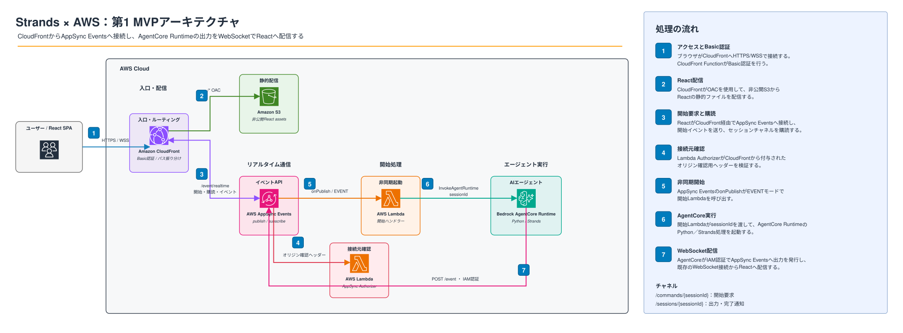

# 第1 MVPのAWS実行構成

CloudFrontをブラウザからの入口とし、Reactの配信とAppSync EventsへのWebSocket接続を同じドメインで受け付ける。開始LambdaがAgentCore Runtimeを起動し、AgentCore上のPython／Strands処理がAppSync Eventsを通じて結果をReactへ配信する。

- 編集用：[アーキテクチャ図（draw.io）](strands-appsync-agentcore.drawio)
- 閲覧用：[アーキテクチャ図（SVG）](strands-appsync-agentcore.svg)
- ブラウザ用：[draw.ioで開く](https://app.diagrams.net/?lightbox=1&edit=_blank#R7V1rb9vWGf6eX0HIQFEPli3eRHmKUsiytAZIV6MKmhZFUVDUkcyFEjWScuwOAyJpSdvEvaK3ZG2z9JJkaZuuKNq6SYZ+2E9hZDuf+hd2LiR1SFFyLIu2U8tG4iPy8PY+7/O85/Ly6PhTqzWNWQGGqer1TIydTcQYUFf0slqvZmJNqxJPxZ46cex4bbWiaoBZ1k0rE5MbjdmyKlcNuWbO1oEV652Am59NzrIxRq6COqyZ08tgNcYoeq1hANME5UysImsmiJ04xjDHnXMwKtxcW2mwcfmcGZcNZVm1gGI1DRBj6nINZGLPPL/EMnb7c7tz325/a3cu2u3v7E7L7nyBTwRPVVv9kyE3lp+B19OY8iq8ET4BH6W8lomlRFioGugiTqGovgpPyqJPTbUMTFiOMZaua5baIB8UvV6Ht4DLsmHo58jmiq6VcaEBnw+fDhWKiqwBb/MZtWwtu9dHG54GanXZcu6jJqOdsGAuy2X9HCqSJ4DPYOi65X7Aj5QDmsaQ+54L34GvaWBT4zqhlSzV0kC8aujNhvdkckkjD2Baa6iE96Yret0qyDVVW8s8DbQVYKmKnIboyloT1sEwW2DVd1k21rszggPQa8Ay1hhYT4AXgAjw8M85YhZWTMIPy65JeGheaNqqc4zvMefII5wY8kzwZizv9oqWIdfLJvO/j5jsmeJv969uffMNy0DXCXcc98nROdLLVk3LsGnoo+qr2DRsuqGrdcvMvPRyWm5auolchk3LmlqtZzRQsdLIFtA8WhZvsvRG2mzICqTNab2RiQvYltjR+AQp48uxuJzTNd3IaMgI8bJsnH1yiuO5Ap+fmSrwBbEgTQ9Eoh8AGt0hUBAkKCDYBAWEwI0KhNkshWCR0/RmuWDAh7Bbl+32G9lGo7hWV5j8Crxn025tbL711dZPV+3WR/b5VhZpRU43APNcs26pNWC37nRfu9u99E+7/d4ZUCrqylkAT3TzOSAr8O/GwwtvPvj1ut26Yrcv74BjYnw4ssmDwk7E2AkUeIJIgceJe2ORCeD9yJZuUEx3jKqpdZA2LUM/6+ga55q4ZxbBqUAMM1UozM8nElEZQaKlRKCMgNR8ZyOEWqGE9B0YcSiNlgwfuGcHu3MDK8dP8H9mjsH+xxSXsp59YFDUnOeuiOjXZwvaSZL4Z2ZqUUC/02n4uPUyjIds+hwKd0XocyBzDsYw18D9fhlUEWJ+jvLKKR7/hBvfezx4uKJrmtwwVUIRJxaxPqShAgIDktECRpEQAtYcPQSwFHASjRufGNV7XdxU+GT9rmtCzVCWKQF4KTEDf1+eeSkxy4lesVeS3CLrbpphe/VZrz7bq8869Z1NM+TMTrFXkkT3vO5+1tvPuvtfTutNC/Et57Q9EjSwRGPSlL/hLYt+7lXwT7osm8vQtRKeD52SS0BbguJnoUZaSbcsvRbiYEQVFQgqMPp5zlEOmEjLZgPdZEVdBWXkQA2Qqa1WURtsFrbihFkowXrTUMBJCA7SY/TXX6MJsTN3oRP9NB3idkmWuF3K8zohRYW71MhigZqoCopunsfBxgaTI1tc1+s3B2lfVY1+M+A9r8DiK/i0rt2DqtBDvj/0JBZnvNI0rklQQgFvoCC5USuXXeQXF6d3Edtc2af1aJAz4RDrBNRTsJzhBTq+QqeiZQlTFRiklQCdzC9TBlCasJuxAp4DOIzvJsgM1ShOIiLFipRI8TylUklx9PCiIfLF4V3Ao1yf6V74qvv2F3bnHmnKhDZigh5AA1nXYVzuuQT+6GOvH4+aWi5rYCB4427W9DgyxOg8sbko9kyeGkujxrE38iEqkN/GvYCv7favdvtLu/Ovh+evHlnDE8tzlLdziTGa3rRko2f6hx9e7t683H3txtY7F4+iuZMh5h6rpxuk09Tz9fYt3GjdsNs37c4Pduf17p1r29fXj6Lx54Wx+Hqo9fHFK6iP646tBMUd6Q1EAo06fIGQaP8nrOOQX8xLhaS/IZfKCYVCIaJOgnPysXQSZsU9UYOEXbpnS3dsWXHkvgEFjq97kK3Jr+p1pjc+8YRmpcvqyhNVK42KKiosyKaqbN9+c/sW6vXZnXft9i+b69/Z7Uvd1y/arXdRxTnVPWTOOfzI9Dwc/9m/nkdizD2PnnOEk8Bz9VDX7uP9sEELpxvCjbsbYvIB0Xn46ZWtq/8INCdplUkVxPy8HzS+kEpyQlRDEeTkB68yvBMDIlAZiEKYuhT5MFV5+Oln3QvfwOYQGUaSTRNY5hGXEsdJHl8pMflRJMRj70FIh9xomGt1JaAfuFd0hbQXs0snwySkkMsL+ZwfrLzEitJCRBLinPzwSAjuOo1ZQ1w4/EJypsj450zCFKXRLGmquQzbKGazZCqGWgJHXE8cj3l89cTxhlFExc/rA1GWprWsG9AuRkBcyGxf90Jn6/O7sF0dKi6F/EI+70ducZEXhFxE4uKc/ODFRXRGHwVpkLgIo4tLD5E+fTkl10plOUxXXOXJekcfdVlZlNhE4jGWFQ1jPZKqBDm9s7BwY590wSOKcfIQff2ez7rvrG9+cm37x5+7lz8Il5YCl08F2i0E0YjaLeTkh2CARYyu3eLDZBfiQsaD7c7buK35ht35t925P9GXo6ovIdQ+kKYLykFSdAME5CV7sn84PXR4JVHgCqwfwQSbTaUWI9IY5+QHrzHzqRCNSY2pb+Sh4hOYBVA2dOUs05c4FqY3S2swgNVhH8nJDzziUuP4zeMrNSUC/iueb4zUqgnQfVgMTUYkOaBcBXEvqcUbVPY8Ee0nZtMN6MJVvS5reXebpyqJdG/vKR2lVKT/AixrDRsfJ4A4iPiz+EC9nEV5zRlFk01TVdCGAvSSTEDDWEHKL2TDTQxWVesFeAD6+2IGemYaJzm8AO8JF8i2GIMeJJCMwRCUQ3PvYECoAqt/CmcQRgbQZEtdIZcYTWcGQBHHE6ye7Dx9+vRSEQrJmWLRBxKmiWvmnSdIw5NT8aUWZOVsFSNLz8B6VNrjJGow9TuEF4N88pFs72UZx1khgMQJeNASela8Wa9UTGBBeBAq7rl2xxsKJJM/XJQZNvERpAw3Cmf65jZdxrjTEVEzxWf8AEnm/sAwz2Zzv2uC+J3vMHPDGRPcH4LgpryfIniTQ5JH5c+w9IQgf6Sx8sc3FL+PJHKvG2ASTmGbM4CsBdq2bhf63vYP97dvf4syTajZm9Bm7e+chq6f75aLqai56ELbG0Y7XMFq2Cg4IRshGeYbOwLZ/NNbHtMC49JRk60fhgDZ7PZtnCO6ATlEJinszsd2p2N3zsPe/++aRiEueuhCmnuP9GjR4SLSsDHfYNTiw6IWPxqT+odh94tLviv72aTXl7yp6fzz+T+fPhIE8jnnoaOQDy5v/ONwkWjYoOY4RhtC5iy8iOQfaoyaROFoBGh0sr4CbYNHOfsHOE1golfuT5aPTHtvgAcfvjafB+e+dr8eOVINyapym3z9LT6Xby/iIdWhcSowaD+m3hV9BDwGPqq8hmsQXw3sx2clqCJP4p1Uc4n3LaXQXzOZEgdVPD6Hr+m78x185NFdJMD8pWeLpxnSAaQofzL7DMlKPzKU76fSYWK7aYFGnPVAYz0odpzyoydkElJuwT8hUwYVualZ9EROAf8MmBhM7jAFUkWCkEkE9GJn9xjsCCO8Y8mJzjxK74U/jppI4VKjJyJAFDgPBW6CwpD5c/dlNGpJljGiwHso8BMUdkZBiAYFwUNBmKAwGAVJIIqUTESiSKKHgjhBYQgKkrO6DRsJF5IeCskJCoNRYBNuEnI0MEgeDNIEhiEw8ByBISntBYbwl8UBbEuX46Vq/1I5u8z3cXufvuydEnpndtaAjfoebhyxg39VIbx0B5dIqxB8aBBxwMom+UXYhSjMTPEJkU/yQ1c1mUoqKVCqjGs1EDbZv2xdkqMS2iRp5IQ2BwS85FXvfXG8NoLdurP5Y8tuj/M9/QELnHmk4LhIX9HfwcxS3wogvsUBeXGvvk76Z/GSDLuSB95Lg7Ye3rHerTTtweQspfL0Imp8ao+O7VjctxYgGqwooZEKtAJL+zu7fc9u/2K3blFv2ePxjJKbk0llcJoNue7A9cRfm7qF0ll1448M5Z9GtfQkTtGcnmFQmRPFGeff9HSaHIWv3vkQ5Zq3b6Dl3Frr9AqFGziza+5MsWi3brorE6LFBe3z7V49ptCsK0gZ4dHUvdvt97avr9uti7Ayfg50zwPTS2lOj7QIoTDEi/rWjNpXPktOD59N9N7/EOm1NiRuLITmAoTmJoSOsfNihITmBhAav8hOlhzYDwbTlF1/NpuDzHvw31+33r+FlhFt3fDery/yZNFRZ7nQO2RpBLvzgd2+jhNlvoZH0muITpjrMHeeD2cuyoEeA3P5AHP5CXNhiz7KUMwPYC7JINu+0dr8vg1DMckj2w8OO5ykwu/Wj+tb738PA+/QNYKdlDcqzQ1x+DxsL1+y0f/3UK5O+2e7Q97RQSs82503CdWdLLkJ1Smqc9KgID0eqgsBqgsTqsd4KUqqCwOoHnj3fj9ITl7+pF4fD7S3UXB+cO/jBxtv2S0YlGHj+Vp//h2K61QKHuTx5pefoPb2hMcUj/lkKtKQLQZ4LE54HBPEKBvb4qCQ7b7oTkLhfvA4GJHveHl9kNA4r8/u4K9W6LwB4ze5L8J9yNbuu5CqP3Rfu4sIO2Gr4znRNrCTAbYmJ2yNiUKUUTc5gK3eq8lk7dX9YKuPf611Lz8QRc6N66SP3PfG9IONS5DX5B3p3+6/7bwj7YxIw6YzXlRjEnJpEot8tONbUoDE0oTEsSQfJYmlAST2vntm/8a4PIJCBnvpfmGdY+8Lcrau3MXjz6iXvPnR591vP4aE9u7c7UNT42Ebk6GvflInucj6w8qyXK8DzQyZEKHGKfbDueYUvVZD+j73Ny86/P23+1fp0SB8cwau7dQJ1nY8r3Ove2f9wd2LD89f3br21ZF2IlelJK6nUiLqJHjNu11MGB+f630PHM5K9b7XDn9n3pzzpXknjqGd6Ev5Thz7Pw==)
- 仕様書：[第1 MVP仕様書](../spec/01-websocket-end-to-end.md)



## 構成

- React：開始操作、セッションチャネルの購読、受信イベントの表示
- CloudFront：React配信と`/event/realtime`の振り分け
- CloudFront Function：Basic認証
- 非公開S3：Reactの静的ファイル保存
- AppSync Events：開始イベントの受付とWebSocket配信
- Lambda Authorizer：CloudFrontから付与されたオリジン確認用ヘッダーの検証
- 開始Lambda：AgentCore Runtimeの非同期起動
- AgentCore Runtime：Python／Strands処理の実行

## 処理の流れ

| 手順 | 送信元 → 送信先 | 動作 |
|---|---|---|
| 1 | ブラウザ → CloudFront | HTTPS／WSSで接続する。CloudFront FunctionがBasic認証を行う。 |
| 2 | CloudFront → S3 | OACを使用して非公開S3からReactの静的ファイルを配信する。 |
| 3 | React → CloudFront → AppSync Events | `/sessions/{sessionId}`を購読し、`/commands/{sessionId}`へ開始イベントを送る。 |
| 4 | AppSync Events → Lambda Authorizer | CloudFrontから付与されたオリジン確認用ヘッダーを検証する。 |
| 5 | AppSync Events → 開始Lambda | `onPublish`から`EVENT`モードで開始Lambdaを呼び出す。 |
| 6 | 開始Lambda → AgentCore Runtime | `sessionId`を指定して`InvokeAgentRuntime`を呼び出す。 |
| 7 | AgentCore Runtime → AppSync Events → React | IAM認証で出力・完了イベントを発行し、既存のWebSocket接続からReactへ配信する。 |

## 認証

- CloudFront FunctionがReact配信とWebSocket接続の初回HTTPリクエストをBasic認証する。
- CloudFrontがAppSync向けリクエストへオリジン確認用ヘッダーを付与する。
- Lambda Authorizerがオリジン確認用ヘッダーを検証する。
- AgentCore RuntimeからAppSync Eventsへのイベント発行にはIAM認証を使用する。

## チャネル

| チャネル | 用途 |
|---|---|
| `/commands/{sessionId}` | Reactから送る開始要求。開始Lambdaを接続する名前空間。 |
| `/sessions/{sessionId}` | AgentCore Runtimeから送る出力・完了通知。Reactが購読する名前空間。 |

## 根拠と図の更新

2026-10-04に公式ドキュメントを確認。AWSサービスにはdraw.ioのAWS4公式アイコンを使用する。

- [AppSync Events：Lambdaの直接統合とEVENTモード](https://docs.aws.amazon.com/appsync/latest/eventapi/direct-lambda-integrations.html)
- [AppSync Events：HTTPによるイベント発行](https://docs.aws.amazon.com/appsync/latest/eventapi/publish-http.html)
- [AppSync Events：WebSocketプロトコル](https://docs.aws.amazon.com/appsync/latest/eventapi/event-api-websocket-protocol.html)
- [AgentCore Runtime：バックグラウンド処理](https://docs.aws.amazon.com/bedrock-agentcore/latest/devguide/runtime-long-run.html)
- [AgentCore Runtime：セッションのライフサイクル](https://docs.aws.amazon.com/bedrock-agentcore/latest/devguide/runtime-sessions.html)

`.drawio`を編集元として保持し、変更時はSVGも再生成する。

```sh
docker run --rm --network none \
  -v "$PWD:/data" -w /data \
  rlespinasse/drawio-export \
  docs/mvp1/infra/strands-appsync-agentcore.drawio \
  --format svg --output /data/docs/mvp1/infra --remove-page-suffix \
  --embed-diagram --embed-svg-images --embed-svg-fonts false --border 24
```
